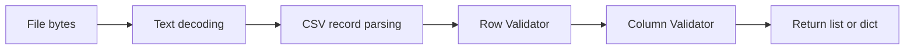
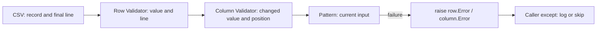

# csvd2c user guide

[한국어](./README.md)

This guide covers CSV record reads, row/column cleansing rules, and error handling rules. See the [project introduction](../README.en.md) for installation and quick start and the [samples index](../samples/README.en.md) for complete runnable examples.

## Reading and cleansing flow

A Validator executes its Patterns in order. Row Patterns operate on column counts, positions, and contents; column Patterns operate on individual strings.



`header()` consumes and stores the next raw record without applying these Validators. Subsequent `row()` or `rows()` calls read records and apply row validation before column validation. Errors propagate to the caller.

## Contents

- [Usage rules](#usage-rules): encoding candidate checks, modes, headers, output types, and lifetime
- [Row structure Patterns](#row-structure-patterns): reordering, merging, splitting, and error handling
- [Column Patterns](#column-patterns): text, dates, numbers, currencies, and encoding recovery
- [Processing principles](#processing-principles): original-data preservation and large-input constraints

## Usage rules

- `detect_encoding(path, *args)` checks an initial sample of up to 1MiB in candidate order and returns the first success. One additional byte determines whether the sample reaches EOF. Missing candidates, empty files, and failure of all candidates are errors. BOMs do not automatically select candidates; use `utf-8-sig` for UTF-8 BOM handling. Sample success guarantees neither the actual encoding nor whole-file validity.
- `CSV.open(path)` wraps a binary file in `TextIOWrapper` and closes it on context exit. It does not automatically consume the first record.
- `open(path, mode="rb")` supports read-only `rb`, `r`, and `rt`. Text modes use the constructor's encoding, errors, and newline settings. Write, append, and update modes are rejected before opening the file.
- `close()` immediately closes the current stream and clears the header and reading state. Repeated calls are safe; generators from a closed stream cannot be reused.
- `header()` consumes the next raw record, stores it as the current header, and returns a copy. Repeated calls consume additional records.
- `row()` returns one next record. `rows()` is a generator of remaining records. Both share the file position and must be used inside the open context.
- `row(header=("name", "date"))` returns a dictionary by mapping validated values to keys in their current order. `rows(header=...)` streams dictionaries. Omitted headers or `None` retain list output. The output header applies only to that call and neither consumes file headers nor changes named validator mapping. Duplicate keys and validated column count mismatches are errors; an empty header maps only an empty record.
- `row()` and `header()` raise `StopIteration` at EOF; `rows()` ends normally.
- Constructor `row` and `cols` configure row and column Validators. Method arguments override them only for that call. Omitted arguments or `None` use constructor settings; no settings means no validation.
- Dictionary `cols` validates only named columns and requires a prior `header()` call. Missing or duplicate selected names are errors. Tuple `cols` validates only the specified prefix.
- Row validation runs before column validation. Header/record column count equality is not enforced automatically; define structural rules in row Patterns. Missing selected record columns are errors.
- `rows()` selects validators and header mapping when called. Changing the header, closing the context, or reopening the file invalidates existing generators.
- Use `delimiter="\t"` for TSV. The default delimiter is comma, with `strict=True` CSV parsing. `escapechar` defaults to `None`; set `escapechar="\\"` to read input such as quoted fields containing backslash-escaped quotes. Parsing and configuration errors follow Python's standard `csv.reader`.

For example, if the first record in `input.tsv` is a header and the next record is `1<TAB>"Acme \"quoted\" name"`, this configuration reads the data row as `['1', 'Acme "quoted" name']`:

```python
from csvd2c import CSV

with CSV(
  delimiter="\t",
  escapechar="\\",
  strict=True,
).open("input.tsv") as data:
  data.header()
  print(data.row())
```

- Decoding, parsing, and validation errors propagate. Consumed records are not automatically retried, and errors are not automatically recovered.
- `surrogateescape` preserves undecodable bytes but does not repair them. Validate these values before sending them to a database. Already stored `�` requires separate validation.
- Input is not loaded in full, but oversized records can increase memory usage. Do not indiscriminately increase the CSV parser's field size limit.

## Validation positions and error contracts

Row `Pattern` and `Validator` use `__call__(value: List[str], row: int) -> List[str]`; column implementations use `__call__(value: str, row: int, column: Union[int, str]) -> str`, omitting `self` here. Direct calls require position arguments. Existing one-argument custom Patterns must be migrated to these signatures.

Injecting Validators into CSV supplies positions automatically. Line numbers are 1-based physical file lines, captured after reading the entire record. A quoted record spanning lines 2–3 reports line 3, not the precise offending character or a logical record number. Tuple column validators receive a 0-based index; named validators receive the configured name. Output `header=` does not change the identifier.

Validation failures are reported as exceptions:

| Class | Base | Constructor | Attributes |
| --- | --- | --- | --- |
| `csvd2c.Error` | `Exception` | `message` | `message` |
| `csvd2c.row.Error` | `csvd2c.Error` | `message, row, value: List[str]` | `message`, `row`, `value` |
| `csvd2c.column.Error` | `csvd2c.Error` | `message, row, column, value: str` | `message`, `row`, `column`, `value` |

`value` is the input of the failing Pattern. If `Strip` transforms `"   "` into `""` and `Required` fails, `value` is `""`. File-original and chain-start snapshots are not retained. Column validation uses the row after row transformations, without tracing fields back to earlier positions. Raise or subclass `csvd2c.Error` for failures without an identifiable position.

```python
from csvd2c.column import Error, Validator
from csvd2c.column.patterns import Required, Strip

validator = Validator(Strip(), Required())
try:
  validator("   ", 2, "name")
except Error as error:
  assert (error.row, error.column, error.value) == (2, "name", "")
  assert error.message == "A nonempty value is required"
```

The per-Pattern `error=` arguments and callable Error handlers have been removed. Callers log, recover, or skip with `try`/`except`. Data validation failures are no longer `ValueError`; replace `except ValueError` with `csvd2c.row.Error`, `csvd2c.column.Error`, or the common `csvd2c.Error`. Configuration errors still raise `TypeError` or `ValueError` immediately. If a record lacks a position selected by a column Validator after row validation, `csvd2c.row.Error` is raised.

Custom Patterns may raise these classes or their subclasses on failure, or return values without raising.

To log failed records and continue, inject Validators directly into CSV, catch only validation errors, and call `row()` again, as in the [rejection sample](../samples/reject_records.py). The same `rows()` generator cannot resume after an exception. Parsing and file decoding failures are not validation errors; positions and source text are not guessed.



## Row structure Patterns

Available row Patterns are imported from `csvd2c.row.patterns`:

- `Length(count)`: require exactly count columns; mismatch raises row Error.
- `Truncate(count)`: remove trailing excess columns; keep all values when count or fewer columns exist.
- `Pad(count, value="")`: append the specified string for missing columns; keep all values when count or more columns exist.
- `Insert(index, value)`: insert a string using Python `list.insert`, including index clipping.
- `Remove(index)`: remove one column using Python indexing; out-of-range indices raise row Error.
- `Reorder(*indices)`: require every column exactly once; reject missing, duplicate, and out-of-range indices.
- `Slice(start=None, stop=None, step=None)`: Python slicing with clipping and negative indices/steps; reject zero step.
- `Merge(start, stop, sep=",")`: merge a nonempty, in-range slice with exclusive stop.
- `Split(index, sep=",", maxsplit=-1)`: split one field using `str.split`.
- `Replace(index, value)`: replace one field with an explicit string.
- `IfLength(count, *patterns)`: run nested Patterns only for matching input counts.
- `RejectEmpty()`: reject empty records or records consisting entirely of empty strings, not whitespace.
- `RejectHeader(*names)`: reject exact header repetitions, including order.

On data failure, Length, Remove, Reorder, Merge, Split, Replace, RejectEmpty, and RejectHeader raise `csvd2c.row.Error` carrying the Pattern's input row and line number. Configuration errors still raise `TypeError` or `ValueError` immediately. No automatic skipping occurs. Insert, Slice, Pad, and Truncate have no data failures.

```python
from csvd2c.row import Validator
from csvd2c.row.patterns import (
  IfLength,
  Length,
  Merge,
)

validator = Validator(
  IfLength(4, Merge(1, 3, sep=",")),
  Length(3),
)
```

Nonmatching counts pass unchanged. Nested exceptions propagate. Compose a final Length check when needed.

Transformations return new lists; `Length` returns the original list unchanged. Negative indices are supported, and `Reorder` checks duplicates after normalization. Callers specify correction positions and values without automatic inference.

```python
from csvd2c.row import Validator
from csvd2c.row.patterns import (
  Length,
  Remove,
)

validator = Validator(
  Remove(1),
  Length(2),
)
result: list[str] = validator(["Kim", "unused", "1-10"], 1)
```

Use this example only when the second column is confirmed to be unwanted.

Explicitly compose trailing truncation and padding when this policy is appropriate:

```python
from csvd2c.row import Validator
from csvd2c.row.patterns import (
  Length,
  Pad,
  Truncate,
)

validator = Validator(
  Truncate(2),
  Pad(2),
  Length(2),
)
```

Counts must be nonnegative integers and padding values must be strings. Both Patterns return new lists without modifying input. This policy does not repair missing middle columns or incorrectly split fields. Preserve the source separately because truncated values are absent from the result.

## Column Patterns

Import from `csvd2c.column.patterns`. Patterns accept a string, line number, and column identifier and return a string, including normalized dates and numbers. Configuration errors are immediate. Data validation failures raise `csvd2c.column.Error` carrying the Pattern's input string and position.

| Pattern | Behavior |
| --- | --- |
| `Strip(chars=None)` | Strip surrounding whitespace or selected characters |
| `CollapseWhitespace()` | Collapse Unicode whitespace runs to one space, without trimming |
| `Replace(old, new, count=-1)` | Literal str.replace semantics |
| `RegexReplace(expression, replacement, count=0, flags=0)` | Regex substitution; zero replaces all matches |
| `Lower()`, `Upper()`, `CaseFold()` | Unicode case transformations |
| `UnicodeNormalize(form="NFC")` | NFC, NFD, NFKC, or NFKD normalization |
| `Required()` | Reject exactly empty strings |
| `Length(minimum=0, maximum=None)` | Inclusive code point length bounds |
| `Regex(expression, flags=0)` | Require fullmatch |
| `Choices(*values)` | Exact allowed string membership |
| `RejectCharacters(chars)` | Reject explicitly selected characters |
| `RejectSurrogates()` | Reject U+D800 through U+DFFF, including surrogateescape markers |
| `RejectReplacementCharacter()` | Reject U+FFFD, not ordinary question marks |
| `Map(values)` | Copy a string mapping and reject unknown values |
| `Default(value)` | Replace exactly empty strings |
| `Date(*formats, output="%Y-%m-%d")` | Parse complete dates and reject distinct interpretations |
| `Number(decimal=".", thousands=None)` | Validate grouping and normalize through Decimal |
| `Range(minimum=None, maximum=None)` | Inclusive numeric bounds, preserving input text |
| `Recode(stored_encoding, original_encoding)` | Reverse an explicitly known misdecoding path |
| `Currency(mapping=None)` | Normalize currency prefixes to ISO 4217 codes, preserving amount formatting |
| `IfEmpty(*patterns)` | Apply nested Patterns only to empty strings |
| `IfMatch(expression, *patterns, flags=0)` | Apply nested Patterns only on fullmatch |
| `IfUndecodable(*patterns)` | Apply nested Patterns only for U+DC80 through U+DCFF markers |
| `RecoverEncoding(source, read_encoding="utf-8")` | Restore field bytes with surrogateescape and strictly decode the specified source |
| `TryRecoverEncoding(source, read_encoding="utf-8")` | Try only marked fields; preserve the input on codec failure |

Required, Length, Regex, Choices, the three rejection checks, Map, Date, Number, Range, Currency, Recode, and RecoverEncoding raise `csvd2c.column.Error` on failure. Conditional Patterns propagate nested exceptions.

```python
from csvd2c.column import Validator
from csvd2c.column.patterns import (
  Date,
  Number,
  Range,
  Required,
  Strip,
)

name_validator = Validator(Strip(), Required())
date_validator = Validator(Date("%Y-%m-%d", "%d/%m/%Y"))
amount_validator = Validator(
  Number(thousands=","),
  Range(minimum=0, maximum=1000000),
)
```

### Important constraints

For fields known to originate in CP1258 and read through UTF-8 with surrogateescape:

```python
from csvd2c import CSV
from csvd2c.column import Validator
from csvd2c.column.patterns import (
  IfUndecodable,
  RecoverEncoding,
  RejectSurrogates,
)

csv = CSV(
  encoding="utf-8",
  errors="surrogateescape",
  cols={
    "description": Validator(
      IfUndecodable(RecoverEncoding("cp1258")),
      RejectSurrogates(),
    ),
  },
)
```

RecoverEncoding re-encodes using the original reading codec with surrogateescape, then strictly decodes source. Failures raise `csvd2c.column.Error`. Apply before stripping, replacement, or Unicode normalization. Results are strings; encode UTF-8 at output. Missing markers do not prove correctness, and successful source decoding does not identify its actual encoding. This cannot repair mixed encodings inside a field, already replaced characters, or information removed by BOM/newline transformations.

Currency validates the 178 codes in the [SIX ISO 4217 List One](https://www.six-group.com/dam/download/financial-information/data-center/iso-currrency/lists/list-one.xml) snapshot published 2026-09-17, including fund, metal, testing, and no-currency codes. It performs no runtime network requests. Withdrawn codes are excluded; future changes require updating the snapshot.

Immutable module constants `CURRENCY_CODES` (code set) and `CURRENCY_ALIASES` (prefix-to-code mapping) are exported from `csvd2c.column.patterns` and the Currency module. The mapping includes code identity mappings and 3,310 aliases. Names, plural variants, and symbols come from [pinned Unicode CLDR data](https://github.com/unicode-org/cldr-json/tree/7d2b9cb11cec08f4d333ad73209deb3df0711c3b/cldr-json/cldr-numbers-full/main) for en, ko, ja, zh, de, fr, es, ar, ru, and hi. Shared aliases are excluded except for existing explicit symbol policies. This is not exhaustive coverage of every regional abbreviation. Unicode-3.0 notices are retained in the data module.

```python
from csvd2c.column.patterns import Currency

currency = Currency()
result: str = currency("CA$1,000", 1, "amount")  # CAD 1,000
custom = Currency({"C$": "CAD"})
```

- Won/fullwidth won maps to KRW, bare dollar/fullwidth dollar to USD, bare yen/fullwidth yen to JPY, euro to EUR, pound/fullwidth pound to GBP, Indian rupee to INR, and ruble to RUB. Bare dollar and yen interpretation is an explicit project policy, not a unique international meaning.
- Country aliases include CA$, AU$, US$, NZ$, HK$, SG$, JP¥, CN¥, CA＄, AU＄, US＄, JP￥, and CN￥. CA/AU/JP/CN followed only by replacement characters or surrogate code points maps to CAD/AUD/JPY/CNY. This identifies currency from the prefix rather than restoring lost symbols.
- Custom mappings are copied, case-sensitive prefix-to-current-code mappings. They override aliases but cannot redirect existing ISO codes. Longer aliases take precedence.
- `US Dollar 100`, `미국 달러 100`, and `日本円 100` normalize to USD, USD, and JPY respectively. Aliases are input interpretation policies, not part of the ISO code standard.
- Output is `CODE amount`, trimming only amount boundaries. The amount must begin with an ASCII digit or `+`, `-`, `.`, `,`, or `(`. Numerical validity is not checked. Unknown prefixes, absent amounts, and damage in amounts raise `csvd2c.column.Error`. Ordinary question marks are not inferred as damaged symbols.
- Number cannot process the entire Currency result directly; separate the code and amount before numeric normalization.

- Date requires exactly one year (%Y or %y), month (%m, %b, or %B), and day (%d). Only these directives and literal %% are supported. Years are not inferred. %y follows Python's century rule. Month names depend on the process locale, which the library does not change.
- Multiple formats resolving to distinct dates are rejected; identical interpretations are accepted.
- Number requires integer digits and fractional digits after any decimal separator. It rejects `.5`, `1.`, exponents, NaN, Infinity, surrounding whitespace, and malformed three-digit grouping. Apply Strip or UnicodeNormalize explicitly when appropriate.
- Number preserves decimal precision without float rounding, removes trailing fractional zeros, and normalizes negative zero. Separators are explicit, never inferred or indiscriminately removed.
- Range uses ungrouped notation. Apply Number first for other formats. Bounds accept finite Decimal, integer, or numeric strings; floats and dates are not supported.
- Recode performs `col.encode(stored_encoding).decode(original_encoding)` strictly. Success does not prove correctness and cannot restore replaced characters. It is separate from file encoding detection.

### Ordered encoding recovery

`TryRecoverEncoding(source, read_encoding="utf-8")` tries only fields with surrogateescape markers. Codec failure preserves the input for the next candidate; success returns Unicode text. Recovered fields without markers pass unchanged. The first successful candidate wins, without language detection. Example: `Validator(IfUndecodable(TryRecoverEncoding("cp949"), TryRecoverEncoding("cp1258")), RejectSurrogates())`.

Callers choose the candidate order and final damage checks. See [column_recover_encoding.py](../samples/column_recover_encoding.py) for a complete reading example.

## Processing principles

- Process large inputs incrementally without accumulating the entire input or output. Record and batch sizes affect memory usage; actual 200GB performance has not been validated.
- Preserve original data and distinguish corrections and their reasons.
- Do not guess ambiguous dates or damaged text.
- Distinguish decoding, CSV parsing, structural, and column validation failures.
- Callers implement classification and storage of accepted, corrected, and review-required data. [reject_records.py](../samples/reject_records.py) demonstrates logging rejected values and reasons separately.

## License

Distributed under the [GNU General Public License v3.0](../LICENSE).
