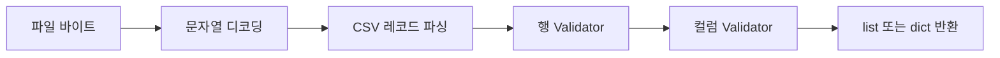

# csvd2c 사용 매뉴얼

[English](./README.en.md)

CSV 레코드 읽기, 행·컬럼 정제 규칙과 오류 처리 규칙을 설명합니다. 설치와 첫 실행은 [프로젝트 소개](../README.md), 전체 실행 예제는 [샘플 안내](../samples/README.md)를 참고하세요.

## 읽기와 정제 흐름

Validator는 여러 Pattern을 지정한 순서대로 실행하는 처리기입니다. 행 Pattern은 컬럼의 개수·위치·내용을 다루고, 컬럼 Pattern은 개별 문자열을 다룹니다.



`header()`는 다음 원본 레코드를 소비해 헤더로 저장하며 위 Validator를 적용하지 않습니다. 이후 `row()` 또는 `rows()`를 호출하면 레코드를 읽고 행 검증 후 컬럼 검증을 실행합니다. 오류는 호출자에게 전파됩니다.

## 목차

- [사용 규칙](#사용-규칙): 인코딩 후보 검사, 읽기 모드, 헤더, 반환 형태와 수명
- [행 구조 Pattern](#행-구조-pattern): 컬럼 재배치·병합·분리와 오류 처리
- [컬럼 Pattern](#컬럼-pattern): 문자열·날짜·숫자·통화 정제와 인코딩 복구
- [처리 원칙](#처리-원칙): 원본 보존과 대용량 처리의 제약

## 사용 규칙

- `detect_encoding(path, *args)`는 앞부분 최대 1MiB를 후보 순서대로 검사하여 첫 성공 인코딩을 반환합니다. 파일 끝 확인을 위해 1바이트를 추가로 읽습니다. 후보 누락, 빈 파일과 모든 후보 실패는 오류입니다. BOM으로 후보를 자동 선택하지 않으며, UTF-8 BOM 처리가 필요하면 `utf-8-sig`를 후보에 넣습니다. 샘플 성공은 실제 인코딩이나 전체 파일의 유효성을 보장하지 않습니다.
- `CSV.open(path)`는 바이너리 파일을 `TextIOWrapper`로 감싸고, 컨텍스트 종료 시 닫습니다. 첫 레코드를 자동으로 소비하지 않습니다.
- `open(path, mode="rb")`는 읽기 전용 `rb`, `r`, `rt`를 지원합니다. 텍스트 모드도 생성자의 인코딩·오류·개행 설정을 사용합니다. 쓰기·추가·갱신 모드는 파일을 열기 전에 거부합니다.
- `close()`는 현재 스트림을 즉시 닫고 헤더와 읽기 상태를 초기화합니다. 반복 호출해도 안전하며, 닫힌 스트림의 generator는 사용할 수 없습니다.
- `header()`는 다음 원본 레코드를 소비하여 현재 헤더로 저장하고 복사본을 반환합니다. 반복 호출할 때마다 다음 레코드를 읽습니다.
- `row()`는 다음 레코드 하나를 반환합니다. `rows()`는 남은 레코드를 하나씩 제공하는 generator입니다. 두 메소드는 같은 읽기 위치를 공유하며 열린 컨텍스트 안에서 사용해야 합니다.
- `row(header=("name", "date"))`는 검증 후 값들을 현재 순서대로 키에 연결하여 dict를 반환합니다. `rows(header=...)`는 dict를 스트리밍합니다. 생략하거나 `None`이면 기존 list 반환을 유지합니다. 출력 헤더는 해당 호출에만 적용되고 파일 헤더를 소비하거나 이름 기반 Validator 매핑을 변경하지 않습니다. 중복 키나 검증 후 컬럼 수 불일치는 오류이며, 빈 헤더는 빈 레코드에만 대응합니다.
- `row()`와 `header()`는 파일 끝에서 `StopIteration`을 발생시키고, `rows()`는 정상 종료합니다.
- 생성자의 `row`는 행 Validator, `cols`는 컬럼 Validator 설정입니다. `row(row=..., cols=...)`와 `rows(row=..., cols=...)`로 해당 호출에만 설정을 교체할 수 있습니다. 생략하거나 `None`을 전달하면 생성자 설정을 사용하며, 생성자에도 없으면 검증하지 않습니다.
- `cols`가 dict이면 현재 헤더에서 지정한 컬럼만 처리합니다. 먼저 `header()`를 호출해야 하며, 지정한 이름이 없거나 중복되면 오류입니다. tuple이면 첫 컬럼부터 지정한 개수만 처리합니다.
- 행 Validator를 먼저 실행하고 그 결과에 컬럼 Validator를 적용합니다. 컬럼 수 일치를 자동으로 강제하지 않으며, 구조 검사는 행 Pattern에서 정의합니다. 처리 대상 컬럼이 행에 없으면 오류입니다.
- `rows()`는 호출 시 검증 설정과 헤더 매핑을 선택합니다. 이후 헤더가 바뀌거나 파일 컨텍스트가 닫히거나 다시 열리면 기존 generator를 사용할 수 없습니다.
- TSV는 `delimiter="\t"`로 읽습니다. 기본 구분자는 쉼표이고 `strict=True`로 CSV 구문을 검사합니다. `escapechar`는 기본값 `None`이며, backslash로 escape된 인용부호 같은 입력을 처리하려면 `escapechar="\\"`로 지정합니다. 값의 해석과 설정 오류는 Python 표준 `csv.reader`를 따릅니다.

예를 들어 `input.tsv`의 첫 레코드가 헤더이고 다음 레코드가 `1<TAB>"Acme \"quoted\" name"`이면 다음 설정으로 데이터 행을 `['1', 'Acme "quoted" name']`으로 읽습니다.

```python
from csvd2c import CSV

with CSV(
  delimiter="\t",
  escapechar="\\",
  strict=True,
).open("input.tsv") as data:
  data.header()
  print(data.row())
```

- 디코딩·파싱·검증 오류는 전파하며, 읽은 레코드를 자동으로 재처리하거나 오류 이후 복구하지 않습니다.
- `surrogateescape`는 해석할 수 없는 바이트를 보존할 뿐 복구하지 않습니다. 해당 값을 검사 없이 DB 등에 전달하지 마세요. 이미 저장된 `�`는 별도로 검증해야 합니다.
- 파일 전체를 적재하지 않지만, 비정상적으로 큰 레코드는 메모리 사용량에 영향을 줍니다. CSV 파서의 필드 크기 제한을 무작정 늘리지 마세요.

## 행 구조 Pattern

행 구조 Pattern은 `csvd2c.row.patterns`에서 가져옵니다.

| Pattern | 동작 |
| --- | --- |
| `Length(count)` | 정확한 컬럼 수 검사, 불일치 시 `ValueError` |
| `Truncate(count)` | 뒤쪽 초과 컬럼 제거, 같거나 적으면 모든 값 유지 |
| `Pad(count, value="")` | 부족한 컬럼을 뒤에 지정값으로 채움, 같거나 많으면 모든 값 유지 |
| `Insert(index, value)` | Python `list.insert` 규칙으로 문자열 삽입, 초과 인덱스는 끝으로 보정 |
| `Remove(index)` | Python 인덱스 규칙으로 한 컬럼 제거, 범위 초과 시 Error 처리 또는 `ValueError` |
| `Reorder(*indices)` | 모든 컬럼을 정확히 한 번 지정하여 재배치, 누락·중복·범위 초과 거부 |
| `Slice(start=None, stop=None, step=None)` | Python 슬라이싱, 음수 지원·범위 잘림·0 step 거부 |
| `Merge(start, stop, sep=",")` | stop 제외 범위 병합, 빈 구간·범위 초과 거부 |
| `Split(index, sep=",", maxsplit=-1)` | 한 컬럼을 `str.split` 규칙으로 분리 |
| `Replace(index, value)` | 한 컬럼을 명시한 문자열로 교체 |
| `IfLength(count, *patterns)` | 개수가 같을 때만 내부 Pattern 순차 적용 |
| `RejectEmpty()` | 빈 레코드 또는 모든 필드가 정확히 빈 문자열인 레코드 거부 |
| `RejectHeader(*names)` | 지정한 헤더와 값·순서가 정확히 같은 레코드 거부 |

`Pattern`은 호출 계약만 정의하며 생성자나 공통 오류 처리 메소드를 제공하지 않습니다. 각 구현체가 오류 처리 필요 여부를 결정합니다. `Length`, `Remove`, `Reorder`, `Merge`, `Split`, `Replace`, `IfLength`, `RejectEmpty`, `RejectHeader`는 선택적인 `error=`를 받습니다. 데이터 검증 실패 시 `row.Error.__call__(row)`를 호출하고 반환된 대체 행을 사용합니다. 없으면 `ValueError`를 발생시킵니다. 생성자 설정 오류는 즉시 전파하며 Error로 보내지 않습니다. Error에는 원본 보호를 위한 행 복사본을 전달합니다. 자동 건너뛰기는 지원하지 않습니다. `Insert`, `Slice`, `Pad`, `Truncate`는 `error` 인자를 받지 않습니다.

`column.Error.__call__(col)`은 대체 문자열을 반환하거나 예외를 발생시키는 계약입니다. 사용자 정의 컬럼 Pattern은 필요할 때 자체 생성자에서 Error를 받고 검증 실패 시 직접 호출합니다. 부모 클래스나 Validator는 예외를 자동으로 가로채지 않습니다.

```python
from csvd2c.row import Validator
from csvd2c.row.patterns import (
  IfLength,
  Length,
  Merge,
)

validator = Validator(
  IfLength(4, Merge(1, 3, sep=",")),
  Length(3),
)
```

조건이 다르면 원래 행을 유지합니다. `IfLength` 내부에서 발생한 `ValueError`도 지정된 Error로 처리할 수 있으며, 처리 결과를 자동 재검증하지 않습니다. 최종 구조 검사가 필요하면 위처럼 `Length`를 조합하세요.

치환 Pattern은 새 list를 반환하여 입력을 보존합니다. `Length`는 검사 후 입력을 그대로 반환합니다. 인덱스는 음수를 지원합니다. `Reorder`는 음수 인덱스를 정규화한 뒤 중복을 검사합니다. 위치나 대체값은 추측하지 않고 호출자가 지정합니다.

```python
from csvd2c.row import Validator
from csvd2c.row.patterns import (
  Length,
  Remove,
)

validator = Validator(
  Remove(1),
  Length(2),
)
result: list[str] = validator(["Kim", "unused", "1-10"])
```

이 예제는 두 번째 컬럼이 불필요하다는 사실이 확인된 입력에만 적용합니다.

뒤쪽 초과 컬럼을 버리고 부족한 컬럼을 빈 문자열로 채우는 정책은 명시적으로 조합합니다.

```python
from csvd2c.row import Validator
from csvd2c.row.patterns import (
  Length,
  Pad,
  Truncate,
)

validator = Validator(
  Truncate(2),
  Pad(2),
  Length(2),
)
```

`count`는 0 이상의 정수여야 하며 `Pad`의 채움 값은 문자열이어야 합니다. 두 Pattern 모두 입력을 보존하는 새 list를 반환합니다. 이 정책은 끝부분의 초과·누락을 전제로 하므로 중간 컬럼 누락이나 잘못 분리된 필드를 복구하지 않습니다. `Truncate`가 제거한 값은 결과에서 사라지므로 원본을 별도로 보존하세요.

## 컬럼 Pattern

`csvd2c.column.patterns`의 Pattern은 문자열을 받아 문자열을 반환합니다. 숫자·날짜도 Python 객체 대신 정규화된 문자열로 반환합니다. 생성자 설정 오류는 즉시 발생하며, 데이터 검증 실패가 가능한 구현체만 선택적인 `error=`를 제공합니다. Error는 원래 문자열을 받아 대체 문자열을 반환하거나 예외를 발생시킵니다. 대체값을 자동 재검증하지는 않습니다.

| Pattern | 동작 |
| --- | --- |
| `Strip(chars=None)` | 앞뒤 공백 또는 명시한 문자 집합 제거 |
| `CollapseWhitespace()` | Unicode 연속 공백을 한 칸으로 치환, 앞뒤 공백 제거는 별도 |
| `Replace(old, new, count=-1)` | 문자열 치환, `str.replace` 규칙 |
| `RegexReplace(expression, replacement, count=0, flags=0)` | 정규식 치환, 0은 전체 치환 |
| `Lower()`, `Upper()`, `CaseFold()` | Unicode 대소문자 정규화 |
| `UnicodeNormalize(form="NFC")` | NFC·NFD·NFKC·NFKD 정규화 |
| `Required()` | 정확히 빈 문자열 거부, 공백은 별도 Strip 적용 |
| `Length(minimum=0, maximum=None)` | Unicode 코드 포인트 길이의 최소·최대 포함 검사 |
| `Regex(expression, flags=0)` | 전체 문자열 일치 검사 |
| `Choices(*values)` | 허용 문자열과 정확한 일치 검사 |
| `RejectCharacters(chars)` | 명시한 문자 중 하나라도 포함하면 거부 |
| `RejectSurrogates()` | U+D800~U+DFFF 거부, surrogateescape 표식 포함 |
| `RejectReplacementCharacter()` | U+FFFD 거부, 정상 물음표는 허용 |
| `Map(values)` | 문자열 대응표 복사 후 적용, 미등록값 거부 |
| `Default(value)` | 정확히 빈 문자열에만 명시한 값 적용 |
| `Date(*formats, output="%Y-%m-%d")` | 완전한 날짜 검사·출력 통일, 서로 다른 해석 거부 |
| `Number(decimal=".", thousands=None)` | 명시한 구분자와 3자리 그룹 검사, Decimal 기반 문자열 정규화 |
| `Range(minimum=None, maximum=None)` | 숫자 최소·최대 포함 검사, 원래 문자열 유지 |
| `Recode(stored_encoding, original_encoding)` | 확인된 오디코딩 경로를 strict 인코딩·디코딩으로 역변환 |
| `Currency(mapping=None)` | 통화 접두부를 ISO 4217 코드로 정규화, 금액 형식은 유지 |
| `IfEmpty(*patterns)` | 정확히 빈 문자열일 때만 내부 Pattern 적용 |
| `IfMatch(expression, *patterns, flags=0)` | 전체 정규식 일치일 때만 내부 Pattern 적용 |
| `IfUndecodable(*patterns)` | U+DC80~U+DCFF 표식이 있을 때만 내부 Pattern 적용 |
| `RecoverEncoding(source, read_encoding="utf-8")` | surrogateescape로 필드 바이트 복원 후 명시한 인코딩으로 디코딩 |
| `TryRecoverEncoding(source, read_encoding="utf-8")` | 표식이 있는 값만 복구 시도, codec 실패 시 원본 유지 |

`Required`, `Length`, `Regex`, `Choices`, 손상 문자 검사 3종, `Map`, `Date`, `Number`, `Range`, `Recode`가 `error=`를 받습니다. 조건 Pattern은 내부 구현체의 오류를 그대로 전파합니다.

```python
from csvd2c.column import Validator
from csvd2c.column.patterns import (
  Date,
  Number,
  Range,
  Required,
  Strip,
)

name_validator = Validator(Strip(), Required())
date_validator = Validator(Date("%Y-%m-%d", "%d/%m/%Y"))
amount_validator = Validator(
  Number(thousands=","),
  Range(minimum=0, maximum=1000000),
)
```

### 날짜·숫자·인코딩 주의사항

컬럼이 CP1258이라는 근거가 있고 UTF-8 + surrogateescape로 읽었다면 다음처럼 조건부 복구할 수 있습니다.

```python
from csvd2c import CSV
from csvd2c.column import Validator
from csvd2c.column.patterns import (
  IfUndecodable,
  RecoverEncoding,
  RejectSurrogates,
)

csv = CSV(
  encoding="utf-8",
  errors="surrogateescape",
  cols={
    "description": Validator(
      IfUndecodable(RecoverEncoding("cp1258")),
      RejectSurrogates(),
    ),
  },
)
```

`RecoverEncoding`은 읽기 인코딩으로 `surrogateescape` 재인코딩하여 바이트를 되찾은 뒤 `source`로 strict 디코딩합니다. 데이터 실패는 `error=` 또는 ValueError로 보고합니다. Strip·치환·Unicode 정규화 전에 적용하세요. 반환은 str이며 최종 저장 단계에서 UTF-8로 인코딩합니다. 표식이 없다고 정상 데이터라는 보장은 없고, CP1258 디코딩 성공도 원래 인코딩의 증거가 아닙니다. 한 필드 내부의 혼합 인코딩이나 이미 저장된 U+FFFD를 복구하지 않습니다. BOM·개행 변환 등 읽기 단계에서 제거·변환된 정보도 자동 복원하지 못합니다.

Currency는 [SIX ISO 4217 List One](https://www.six-group.com/dam/download/financial-information/data-center/iso-currrency/lists/list-one.xml)의 2026-09-17 공개본에 있는 178개 코드를 검증하며, 실행 중 네트워크 요청은 하지 않습니다. 펀드·귀금속·테스트·통화 없음 코드도 목록에 포함됩니다. 과거 폐지 코드는 지원하지 않으며 목록 변경 시 코드 갱신이 필요합니다.

`CURRENCY_CODES`는 읽기 전용 코드 집합이고 `CURRENCY_ALIASES`는 읽기 전용 표기→코드 매핑입니다. `csvd2c.column.patterns`와 Currency 모듈에서 가져올 수 있습니다. 매핑에는 모든 코드의 자기 매핑 및 총 3,310개 표기를 포함합니다. [고정된 Unicode CLDR 자료](https://github.com/unicode-org/cldr-json/tree/7d2b9cb11cec08f4d333ad73209deb3df0711c3b/cldr-json/cldr-numbers-full/main)의 영어·한국어·일본어·중국어·독일어·프랑스어·스페인어·아랍어·러시아어·힌디어 통화 이름, 단복수형, 기호·로컬 표기를 사용합니다. 여러 코드가 공유하는 표기는 제외하고 기존 명시 정책만 우선 적용합니다. 모든 지역 약어를 지원하는 것은 아니며 사용자 매핑으로 보완할 수 있습니다. CLDR 데이터의 Unicode-3.0 고지는 데이터 모듈에 보존합니다.

```python
from csvd2c.column.patterns import Currency

currency = Currency()
result: str = currency("CA$1,000")  # CAD 1,000
custom = Currency({"C$": "CAD"})
```

- `₩`·`￦`는 KRW, `$`·`＄`는 USD, `¥`·`￥`는 JPY, `€`는 EUR, `£`·`￡`는 GBP, `₹`는 INR, `₽`는 RUB로 변환합니다. 단독 달러·엔 기호의 해석은 국제 표준의 유일한 의미가 아니라 이 프로젝트에서 선택한 정책입니다.
- `CA$`, `AU$`, `US$`, `NZ$`, `HK$`, `SG$`, `JP¥`, `CN¥`를 구분하고, `CA＄`, `AU＄`, `US＄`, `JP￥`, `CN￥`도 지원합니다. 국가 접두부 뒤 U+FFFD 또는 surrogate 문자만 연속된 경우에도 CA/AU/JP/CN을 CAD/AUD/JPY/CNY로 해석합니다. 원래 손실된 기호 자체를 복원하는 것은 아닙니다.
- 매핑 키는 정확한 접두부 문자열, 값은 현재 ISO 코드입니다. 사용자 매핑은 복사하며 기본 기호를 재정의할 수 있지만 ISO 코드를 다른 코드로 바꿀 수는 없습니다. 긴 접두부부터 검사합니다. 대소문자는 구분합니다.
- 예를 들어 `US Dollar 100`, `미국 달러 100`, `日本円 100`은 각각 `USD 100`, `USD 100`, `JPY 100`으로 반환합니다. alias는 ISO 표준 자체가 아니라 별도의 입력 해석 정책입니다.
- 결과는 `CODE + 공백 + 금액`입니다. 금액의 앞뒤 공백만 제거하고 구분자·소수점·내부 공백을 유지합니다. 금액은 숫자 또는 `+`, `-`, `.`, `,`, `(`로 시작해야 하며 숫자 유효성 검사는 하지 않습니다.
- 미등록 접두부, 금액 누락, 금액 내부 손상 문자는 `error=`로 처리하거나 ValueError를 발생시킵니다. `?`는 손상 기호로 추정하지 않습니다. Currency 결과 전체에는 Number를 바로 적용할 수 없으며 숫자 정규화가 필요하면 코드와 금액을 분리해야 합니다.

- Date 입력 형식은 연도(`%Y` 또는 `%y`), 월(`%m`, `%b`, `%B`), 일(`%d`)을 각각 한 번 포함해야 합니다. 지원 지시자는 이들 및 리터럴 `%%`로 제한합니다. 연도를 추정하지 않으며, `%y`는 Python의 2자리 연도 해석 규칙을 따릅니다. 문자 월 이름은 프로세스 로캘에 영향을 받습니다. 라이브러리는 로캘을 변경하지 않습니다.
- `01/02/2024`가 여러 형식에서 다른 날짜로 해석되면 오류입니다. 같은 날짜로 해석되는 중복 형식은 허용합니다.
- Number는 정수부 숫자를 필수로 요구하며, 소수점 뒤에도 숫자가 있어야 합니다. `.5`, `1.`, 지수 표기, NaN·Infinity, 앞뒤 공백은 거부합니다. Strip이나 UnicodeNormalize가 필요하면 명시적으로 먼저 적용하세요.
- Number는 부동소수점 반올림 없이 끝 소수부 0을 제거하고 음수 0을 `0`으로 반환합니다. 구분자를 자동 추정하지 않으며 쉼표를 일괄 삭제하지 않습니다.
- Range는 그룹 구분자가 없는 숫자 표기를 사용합니다. 다른 표기는 Number로 먼저 정규화하세요. 경계값은 유한 Decimal, 정수 또는 숫자 문자열이며 float와 날짜 비교는 지원하지 않습니다.
- Recode는 `col.encode(stored_encoding).decode(original_encoding)` 순서입니다. 성공해도 복구한 내용이 맞다는 보장은 없고 이미 대체된 문자도 복원하지 못합니다. 전체 파일의 인코딩 감지와는 별개입니다.

### 후보 순서에 따른 인코딩 복구

`TryRecoverEncoding(source, read_encoding="utf-8")`는 surrogateescape 표식이 있는 필드만 복구를 시도합니다. 성공하면 Unicode 문자열을 반환하고, 디코딩 실패 시 원본을 유지하여 다음 후보로 넘어갑니다. 표식이 사라진 값은 다시 변환하지 않습니다. 후보 순서대로 첫 성공을 채택하며 언어 감지는 하지 않습니다. 예: `Validator(IfUndecodable(TryRecoverEncoding("cp949"), TryRecoverEncoding("cp1258")), RejectSurrogates())`.

후보 순서와 최종 손상 문자 검사는 호출자가 정합니다. 전체 읽기 예제는 [column_recover_encoding.py](../samples/column_recover_encoding.py)를 참고하세요.

## 처리 원칙

- 200GB를 넘는 입력도 파일 전체나 처리 결과 전체를 메모리에 적재하지 않고 순차적으로 처리하는 것을 목표로 합니다. 개별 레코드의 크기와 처리 배치 크기는 메모리 사용량에 영향을 줍니다.
- 원본을 보존하고, 보정한 값과 처리 사유를 구분할 수 있도록 합니다.
- 모호한 날짜나 손상된 문자열을 임의로 추측하여 복구하지 않습니다.
- 디코딩 오류, CSV 파싱 오류, 구조 오류와 컬럼 검증 실패를 구분하여 보고합니다.
- 정상 결과, 보정 결과와 확인이 필요한 데이터의 분류·저장은 호출자가 구현합니다. [reject_records.py](../samples/reject_records.py)는 검증 실패의 원본과 이유를 별도 파일에 기록하는 예제입니다.

## 라이선스

이 프로젝트는 [GNU General Public License v3.0](../LICENSE)에 따라 배포됩니다.
